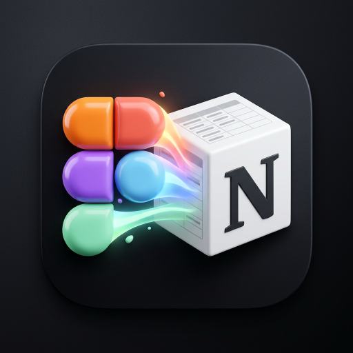
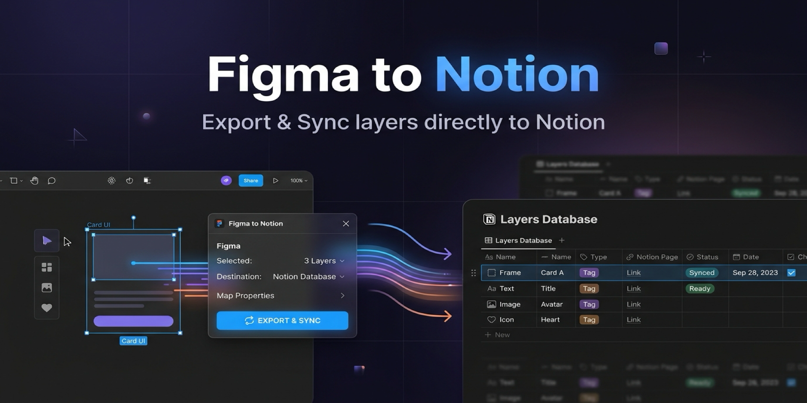

# 🎨 Figma to Notion

<div align="center">



### Seamlessly export and synchronize Figma layers directly into your Notion database.

[](https://www.figma.com/community)
[](https://developers.notion.com/)
[](LICENSE)

<br/>



</div>

---

## 📖 Overview

**Figma to Notion** is a powerful productivity plugin for Figma and FigJam designed to bridge design work and project documentation. It allows designers and teams to export selected layers (Text, Frames, Images, Groups, and Shapes) directly into a structured Notion database with automated PNG rendering for visual elements.

Perfect for:
- 🚀 **Design-to-Dev Handoff:** Keep specs, copy, and visual assets documented in Notion.
- 🎨 **Design System Asset Tracking:** Audit and index components, icons, and illustrations.
- 📋 **Design Tasks & Feedback:** Turn Figma elements into actionable Notion tasks with direct links.

---

## ✨ Features

- **Multi-layer Support:** Automatically identifies and labels layers as `Text`, `Image`, `Frame`, `Group`, or `Shape`.
- **Automatic Asset Rendering:** Frames and Images are automatically rendered as high-res PNGs and uploaded to Notion.
- **Deep Linking:** Generates direct deep links back to each Figma layer for instant navigation.
- **Hierarchical Relations:** Preserves hierarchy with `In section` and `Connected to` self-relations.
- **Local & Secure:** Your Notion integration token and configuration are stored locally in Figma's `clientStorage`—never transmitted to any third-party server.
- **Smart Rate-Limiting:** Built-in throttling compliant with Notion API's rate limits (approx. 3 requests/sec).

---

## 🛠️ Notion Database Setup

To use this plugin, you need a Notion Database configured with the properties below.

### 1. Create a Notion Internal Integration
1. Go to [Notion Integrations](https://www.notion.so/profile/integrations).
2. Click **+ New integration**.
3. Name it (e.g., `Figma Integration`), select your workspace, and copy the **Internal Integration Secret**.

### 2. Configure Your Database Properties
Create a new database in Notion with the following properties (**case-sensitive**):

| Property Name | Type | Description |
| :--- | :--- | :--- |
| **`Name`** | `Title` | Layer name in Figma |
| **`Type`** | `Select` | Layer category (`Text`, `Image`, `Frame`, `Group`, `Shape`) |
| **`Status`** | `Status` | Item progress (must include options: `To do`, `Removed`) |
| **`Figma`** | `URL` | Direct URL link to the selected layer in Figma |
| **`Figma key`** | `Rich Text` | Unique Figma layer / node ID |
| **`Figma hash`** | `Rich Text` | Content hash for change detection |
| **`Change log`** | `Rich Text` | Sync notes and status updates |
| **`Label`** | `Rich Text` | Additional custom label |
| **`Last synced`** | `Date` | Timestamp of the last successful sync |
| **`In section`** | `Relation` | Related to **this database** (Parent section) |
| **`Connected to`** | `Relation` | Related to **this database** (Connected nodes) |

> 💡 **Tip:** Create a **Board View** grouped by `Type` or `Status` for a clean visual workflow!

### 3. Connect Integration to Database
1. Open your database in Notion.
2. Click the `...` menu at the top-right corner.
3. Scroll to **Connections** > Search and select your integration.
4. Copy the Database URL from your browser address bar.

---

## 🚀 Installation & Local Development

### For Developers (Manual / Local Setup)

1. Clone this repository:
   ```bash
   git clone https://github.com/Tapakorn086/figma-to-notion.git
   cd figma-to-notion
   ```

2. Open **Figma Desktop**.
3. Navigate to: `Plugins` > `Development` > `Import plugin from manifest...`
4. Select the [`manifest.json`](manifest.json) file in this repository.
5. The plugin is now ready under `Plugins` > `Development` > `Figma to Notion`.

---

## 💡 How to Use

1. Select one or more layers, frames, or components on your Figma canvas.
2. Run the **Figma to Notion** plugin.
3. Under **Settings**, enter your **Notion API Token** and **Database URL**, then click **Save**.
4. Review the detected layers in the list, adjust their types if needed, and click **Export to Notion** (ส่งไป Notion).
5. Watch the progress bar as items and images are uploaded to your Notion database!

---

## 🔒 Security & Privacy

- **No Third-Party Backend:** All network requests are made directly from your Figma client to `https://api.notion.com`.
- **Local Storage:** Credentials never leave your machine; they are encrypted and managed via Figma's native `clientStorage` API.

---

## 📄 License

This project is licensed under the [MIT License](LICENSE).
